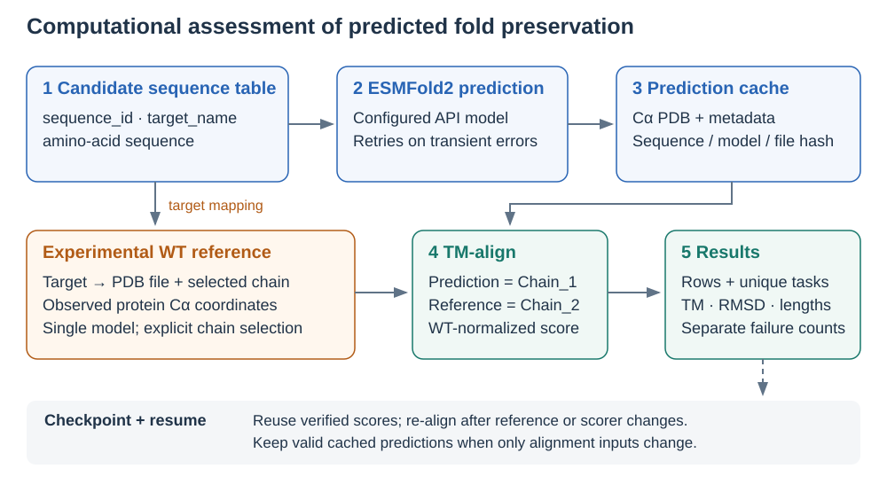
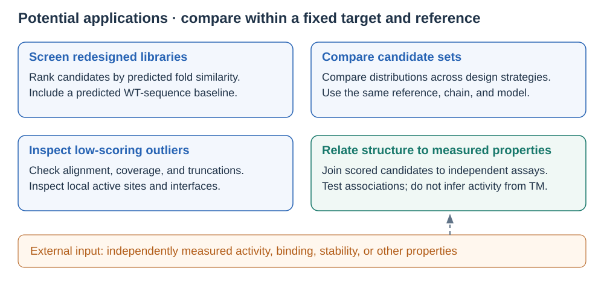
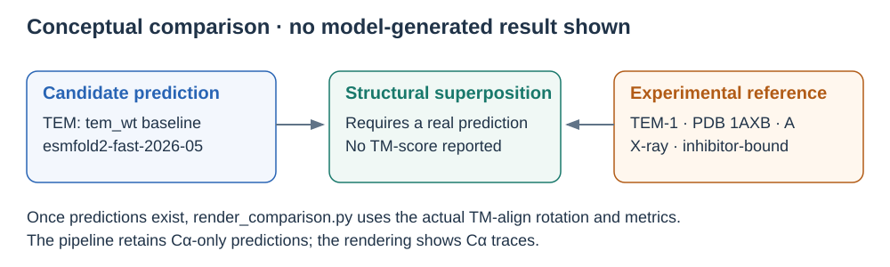

# Predicted fold preservation against experimental protein references

How closely does a candidate's predicted structure resemble the experimentally determined WT structure? This pipeline predicts a structure from each candidate amino-acid sequence with the configured ESMFold2 API model, then compares that prediction with the appropriate experimental reference using TM-align.

This is a computational assessment of predicted fold preservation. Structural similarity alone does not establish experimental folding, stability, catalytic activity, binding, or biological function.



*Each target maps to an explicit reference file and chain. Verified prediction caches and checkpoints support interrupted batches; failures remain visible.*

## Potential applications



*Use a fixed reference, chain, and model when comparing candidate sets. Experimental measurements are external inputs, never inferred by this pipeline.*

See [application workflows](docs/APPLICATIONS.md) for executable analysis, including repeated sequences and failed predictions.

## Installation

Requires Python 3.10+, the dependencies below, and the [TM-align executable](https://zhanggroup.org/TM-align/) named `TMalign` on `PATH` for scoring. No local GPU or model weights are needed.

```bash
git clone https://github.com/yashah929/seqs_to_tm_align_esmfold2.git
cd seqs_to_tm_align_esmfold2
python3 -m venv .venv
source .venv/bin/activate
python3 -m pip install -r requirements.txt
```

For live runs, create a token in the [Biohub developer console](https://biohub.ai/developer-console/api-keys) and set `ESM_API_KEY` in your environment. Offline preparation needs neither credentials nor TM-align. The pipeline requests `POST https://biohub.ai/api/v1/fold`, explicitly selecting `esmfold2-fast-2026-05` by default; override with `--model`. The [official endpoint reference](https://docs.biohub.ai/api/protein/models/fold) documents this service and default. This deployed ESMFold2 variant is distinct from the original 2023 ESMFold model.

## Quick start: offline first

From the repository root:

```bash
python3 run_sequence_tm_pipeline.py run \
  --input examples/full_run_template/sequences.csv \
  --targets examples/full_run_template/targets.csv \
  --outdir outputs/prepared --prepare-only
```

This validates four real sequences, resolves the bundled reference paths relative to `targets.csv`, prepares chain-A coordinates, and writes `pending` output rows. It makes no predictions and reports no scores. `./run_smoke_test.sh` is also offline by default.

Optional live smoke test (one TEM baseline prediction; requires API access and may consume quota):

```bash
# Set ESM_API_KEY in this shell using your normal secret-management method.
command -v TMalign
python3 run_sequence_tm_pipeline.py run \
  --input examples/full_run_template/sequences.csv \
  --targets examples/full_run_template/targets.csv \
  --outdir outputs/live_smoke --limit 1 \
  --max-concurrent-requests 1 --max-concurrent-tmalign 1
```

## Worked example: TEM and APH

The bundled table contains deposited chain-A sequences (`tem_wt`, `aph_wt`) as prediction baselines, plus synthetic first-residue substitutions (`tem_smoke_mutant`, H1A; `aph_smoke_mutant`, M1A). Mutation positions refer to the input sequence, not PDB numbering. These are teaching variants with no claimed experimental properties. Sequences come from each bundled PDB's `SEQRES`, not from previously generated predictions.

| Target | Experimental reference | Construct and observed coverage |
| --- | --- | --- |
| TEM-1 β-lactamase | [1AXB](https://www.rcsb.org/structure/1AXB), chain A, X-ray, 2.00 Å | 263 deposited and observed residues; mature construct, mapped to UniProt P62593 residues 24–286; inhibitor-bound, not an apo full precursor |
| APH(3′)-IIa | [1ND4](https://www.rcsb.org/structure/1ND4), chain A, X-ray, 2.10 Å | 264 deposited residues, 255 observed Cα atoms; residues 1–9 unresolved; kanamycin-bound |

The local TEM header says `MUTATION: YES`, while current RCSB annotation says zero mutations. We retain that discrepancy and do not certify the construct as canonical WT. See [reference details and limitations](docs/SCIENTIFIC_CONTEXT.md).

Run all four candidates by omitting `--prepare-only` and using a separate live output directory:

```bash
./run_full_pipeline.sh examples/full_run_template/sequences.csv \
  examples/full_run_template/targets.csv outputs/example \
  --max-concurrent-requests 1
python3 examples/analyze_results.py outputs/example/sequence_results.csv \
  --outdir outputs/example/analysis
```

A predicted WT-sequence baseline contextualizes variant scores against the same experimental reference. It does not fully separate model error from mutation effects or experimental construct/conformation differences.



*No genuine predictions are bundled in this repository. This diagram is conceptual. Once a scored prediction exists, generate a real Cα superposition from TM-align's transformation and computed metrics:*

```bash
python3 -m pip install -r docs/requirements-figures.txt
python3 docs/assets/render_comparison.py \
  --results outputs/example/sequence_results.csv --sequence-id tem_wt \
  --protein TEM-1 --reference-accession 1AXB \
  --out outputs/example/tem_wt_comparison.svg
```

## Input and output

Provide CSV or TSV tables; [bundled inputs](examples/full_run_template/) are runnable.

| Table | Required columns | Optional columns |
| --- | --- | --- |
| Candidates | `sequence_id,target_name,sequence` | Extra columns are not propagated; join metadata by ID downstream |
| Targets | `target_name,template_path` | `template_chain,description` |

Sequences use the 20 standard amino acids; whitespace is removed and lowercase is normalized. IDs must be nonblank. Set an explicit chain for multichain references. Relative structure paths resolve from the target table's directory.

The main output is `sequence_results.csv`, one row per input row. `unique_results.csv` has one task per distinct target + sequence + requested model; repeated sequences within a target share a task even if their input IDs differ. `summary.json` reports row and unique-task counts, status counts, and **row-weighted** per-target score statistics excluding failures. Normalized inputs, an append-only checkpoint, retry log, prepared references, and prediction caches support inspection and resumption. See the [output field guide](docs/USAGE.md).

## Reading the scores

`TMalign prediction.pdb reference.pdb` makes Chain_1 the prediction and Chain_2 the experimental reference.

| Field | Meaning |
| --- | --- |
| `tm_score` | TM-score normalized by the supplied reference structure length; primary endpoint |
| `tm_score_query` | TM-score normalized by the predicted structure length |
| `rmsd` | RMSD of the aligned residues, in ångströms |
| `aligned_length`, `seq_identity_aligned` | Number of aligned residues and identical-residue fraction within that alignment |
| `predicted_length`, `wt_length` | Cα lengths actually read by TM-align, not necessarily input or canonical sequence lengths |

Higher TM-score indicates greater global structural similarity; no universal cutoff proves successful design. Inspect reference coverage (`aligned_length / wt_length`), truncations, construct differences, and prediction uncertainty alongside the scores. A high global score can overlook local active-site or interface changes. Coordinate-array responses are reduced to Cα-only PDBs; their zero B factors are placeholders, **not model confidence**.

## Further documentation and primary sources

- [Usage, retries, resumability, and provenance](docs/USAGE.md)
- [Applications and downstream analysis](docs/APPLICATIONS.md)
- [Scientific context, service verification, and reference provenance](docs/SCIENTIFIC_CONTEXT.md)
- [Behavior changes and offline validation](docs/CHANGES.md)
- [Zhang & Skolnick, TM-align (2005)](https://doi.org/10.1093/nar/gki524)
- [Biohub ESMFold2 model documentation](https://biohub.ai/models/esmfold2) and its linked [2026 preprint](https://www.biorxiv.org/content/10.64898/2026.06.03.729735)
- [Lin et al., original ESMFold (2023)](https://doi.org/10.1126/science.ade2574), historical background, not a methods citation for the deployed ESMFold2 variant

`run_final_tm_scores.py` is the preserved experiment-specific predecessor; use `run_sequence_tm_pipeline.py` for new batches.
